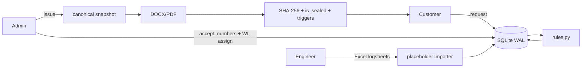

# CPRI ATRG — Automated Test Report Generation

Hackathon prototype for the **Short Circuit Laboratory, CPRI Bengaluru**. A local-network web app that
takes a transformer test job from the customer's request to a **sealed, tamper-evident test report**
in the exact CPRI format (11 sheets), with:

- three separate portals — **Customer**, **Test Engineer**, **Test In-charge / HOD (admin)**
- Excel logsheet templates whose values are imported **by placeholder**, not by cell position
- automatic calculations and IS 1180 rule checks (pass/fail with the limit and formula shown)
- atomic sample-code / report-number allocation (`HVD25S0847`, `CPRIBLRSCL25T1654`)
- optimistic locking for many simultaneous users, a server-side state machine
- SHA-256 sealing, database triggers that block any change after issue, a hash-chained audit log

## 1. Install

Requires Python 3.10+ on Windows (macOS/Linux also work).

```bash
python -m venv .venv
```
```bash
.venv\Scripts\activate
```
```bash
pip install -r requirements.txt
```

**PDF export** is detected at start-up: LibreOffice (`soffice`) if installed, otherwise Microsoft Word
(via COM, as `docx2pdf` does). If neither exists the reports are served as DOCX and a notice is shown.

## 2. Run

```bash
python seed.py --reset
```
```bash
python run.py
```

`seed.py` creates the demo accounts and runs the real workflow once for the demo transformer, so an
issued report (`CPRIBLRSCL25T1654`) already exists. `run.py` starts **waitress** on `0.0.0.0:5000`
with 8 threads and prints both URLs:

```
 Local:   http://localhost:5000
 LAN:     http://192.168.1.23:5000   <- open this on other computers
```

Port: `python run.py --port 8080` or `set ATRG_PORT=8080`.

### Demo accounts

| Portal | Username | Password | Notes |
|---|---|---|---|
| Admin (Test In-charge / HOD) | `admin` | `admin123` | |
| Engineer | `engineer1` | `eng123` | approved |
| Engineer | `engineer2` | `eng234` | **pending** — approve it on *Admin → Engineers* |
| Customer | `customer1` | `cust123` | A.P. Transformers |

New admins need the invite code `CPRI-ADMIN-2026` (`config.py` / `ATRG_ADMIN_INVITE_CODE`).
New engineers stay pending until an admin approves them.

## 3. Use it from other computers (LAN)

1. Connect all computers to the same Wi-Fi / LAN. The laptop running `run.py` is the server.
2. Allow port 5000 through Windows Firewall on the server laptop (PowerShell **as Administrator**):

```bash
netsh advfirewall firewall add rule name="CPRI ATRG 5000" dir=in action=allow protocol=TCP localport=5000
```

3. On the other computers open the **LAN** URL printed by `run.py` (e.g. `http://192.168.1.23:5000`).
   If Windows asked "Allow Python on private networks?" on first start, click **Allow**.

Each role keeps its own session key, so one browser can be logged in as customer in one tab and admin
in another during the demo.

## 4. Two-minute demo script

| Time | Who | Do |
|---|---|---|
| 0:00 | Customer | Landing page → **Customer** → log in `customer1`. **New test request** → *Upload filled Excel* → pick `sample_data/customer_request_filled.xlsx` (form fills itself) → *Select all tests* is ticked → tick declaration → **Submit**. Timeline shows *Submitted*. |
| 0:25 | Admin | New tab → **Admin** → `admin`. Dashboard KPIs → open the request → condition *Suitable / Yes* → **Accept** → sample code `HVD26S0847` + report no `CPRIBLRSCL26T1654` allocated, work instruction downloadable. Choose *P. Naveenkumar* → **Assign**. |
| 0:45 | Engineer | New tab → **Engineer** → `engineer1` → open the job. On each of the 5 tabs upload the matching file from `sample_data/` (each tab has a template download with the header pre-filled). Rule badges turn green. |
| 1:10 | Engineer | On *Losses* click **Edit** on "Top oil temperature After STC", change 27.0 → 27.1, give a reason → shown as corrected, history kept. **Mark verified** on each tab → **Lock job for review**. |
| 1:30 | Admin | Open the job → review: rule results with limits, corrections history, **Generate preview** (filled CPRI report) → **Approve & Issue**. |
| 1:45 | Customer | Refresh: *Report issued* → **Download PDF**, **Verify integrity** → ✅. Admin → *Activity log* → **Verify chain** ✅. Try to edit after issue: blocked (UI + database trigger). |

## 5. Tests

```bash
python -m pytest
```

Covers: 50 concurrent number allocations, sealed-record triggers (UPDATE/DELETE after issue fails
in SQLite), audit chain verification and tamper detection, Excel import round-trip (incl. moved cells,
lost defined names, non-numeric values, wrong sample code), report placeholder completeness and key
values (HV rise 39.7 °C, ΔX −0.163 %, NLC 1.28 %), workflow / role separation / HTTP 409 conflicts,
and the rule calculations.

End-to-end browser check (Playwright, server must be running):

```bash
python -m playwright install chromium
```
```bash
python tests/e2e/e2e_flow.py
```

It registers a customer, submits a request with all tests, accepts and assigns, uploads all
`sample_data` logsheets, corrects a value with a reason, verifies, locks, previews and issues,
downloads the PDF, verifies integrity, proves an edit after issue is blocked, and renders the PDF
pages to `e2e_output/` for visual inspection.

## 6. Project layout

```
run.py  config.py  seed.py  requirements.txt
app/
  __init__.py      Flask factory, CSRF, error handlers
  db.py schema.sql SQLite (WAL) + sealing/append-only triggers
  auth.py          per-role logins, @role_required
  workflow.py      state machine + optimistic locking
  numbering.py     atomic sample code / report number
  jobs.py          accept, assign, import, correct, verify, lock, issue, amend
  excel_io.py      logsheet templates + placeholder importer
  rules.py         calculations and limit checks
  report.py        snapshot -> DOCX (docxtpl) -> PDF, work instruction
  audit.py         hash-chained activity log
  integrity.py     hashing + verification
  request_form.py  customer request form definition (HTML + Excel)
  routes/          public, customer, engineer, admin, api
  templates/ static/
mappings/fields.yaml          single source of truth for 681 readings
templates/report_template.docx  CPRI format with Jinja tags (made by tools/make_template.py)
templates/excel/*.xlsx        logsheet templates (made by tools/make_excel_templates.py)
sample_data/*.xlsx            filled logsheets for the real demo transformer (Sl. No. 1098)
reference/                    the scanned CPRI formats and the original report template
storage/{uploads,reports,sealed,preview}/
docs/architecture.md          data-flow and module diagrams
tests/
```

Regenerate the generated assets after changing `fields.yaml` or the reference template:

```bash
python tools/make_excel_templates.py
```
```bash
python tools/make_template.py
```

## 7. Architecture

See [docs/architecture.md](docs/architecture.md) for the Mermaid diagrams. In short:



## 8. Notes and limits of the prototype

- Scanned logsheets are not OCR'd; readings come in through the structured Excel templates.
- Corrections after issue create an **amended report** (`…/A1`) that references the original; the original is never modified.
- The QR code on the cover and the notes sheet points to `/verify/<report no>` on the server that issued it.
- Limits (impedance tolerance, temperature-rise limits, ΔX, NLC %, …) are editable on *Admin → Config*.
