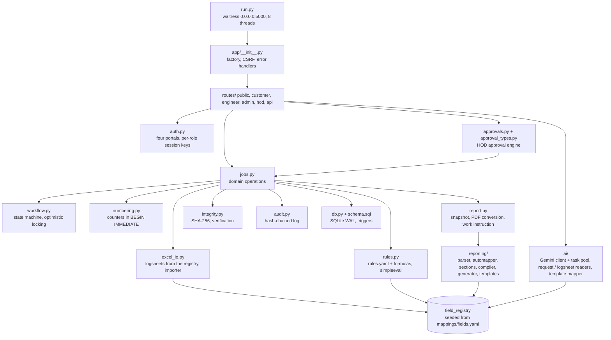
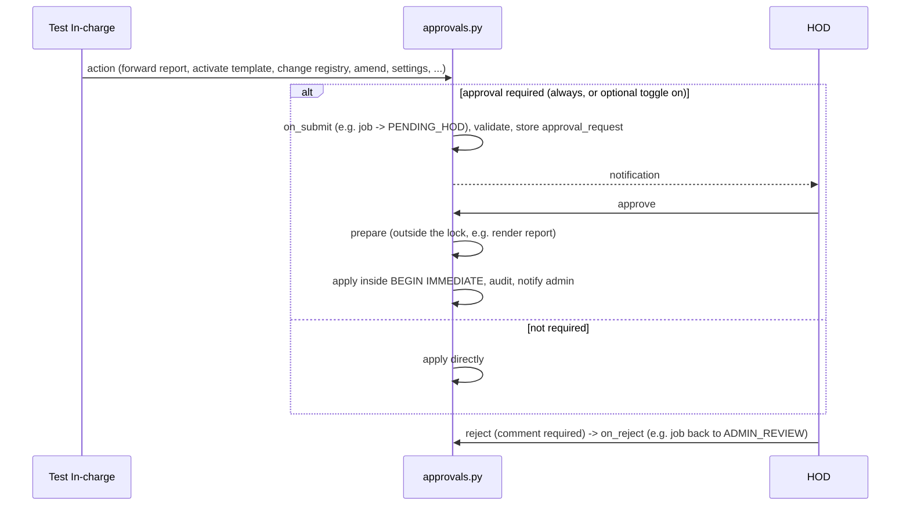

# ATRG architecture (v2)

## Modules

## Data flow

```mermaid
flowchart LR
    C1[Scanned request PDF] -->|PyMuPDF pages + Gemini JSON schema| C2[Pre-filled form<br/>low confidence = Please check]
    C3[Manual form / Excel] --> C2
    C2 -->|customer confirms| R[(requests)]
    R --> A1[Admin accepts<br/>sample code + report no.<br/>work instruction]
    A1 --> A2[Assign engineers]
    A2 --> E1[Excel logsheet generated<br/>from the registry]
    E1 --> E2[Import by defined name / token]
    S1[Scanned logsheet] -->|Gemini, optional| E2
    E2 --> RD[(readings<br/>imported / current / source)]
    RD --> E3[Corrections with reason]
    RD --> RU[rules.yaml -> test_results]
    RU --> E4[Verify each test -> lock]
    E4 --> A3[Technical review<br/>live preview]
    A3 -->|forward| H1[HOD authorization]
    H1 -->|approve| SNAP[Canonical snapshot<br/>+ active template id/version/hash]
    SNAP --> GEN[Generator -> DOCX -> PDF]
    GEN --> SEAL[SHA-256 -> reports, is_sealed=1<br/>DB triggers freeze the job]
    SEAL --> CUST[Customer download + verify]
```

## Approval flow

## Report template pipeline

1. **Parse** (`docx_parser.py`): body, header and footer are read into blocks. Sheets start at a marker
   paragraph ("TEST REPORT"). Value slots are empty value cells, `XXXX` dummies, `{{placeholders}}`,
   unit-only cells, observation cells, inline numbers and "Label :" paragraphs. Each slot gets a label
   context (row label, column header, table title, heading) and a fingerprint.
2. **Auto-map** (`automapper.py`): placeholder name, then the fingerprint of the active version's
   mapping, then rapidfuzz scoring against each registry field's `report_label` ("row || column"),
   then optional Gemini proposals. Repeating rows (ratio taps, drawings) and the schedule of tests are
   recognised structurally.
3. **Edit** (`admin/templates/<id>`): the document is shown as HTML with every slot highlighted. Each slot
   can be bound to a field, fixed text, a safe expression or ignored. Sections are anchored by text and
   tied to test codes.
4. **Compile** (`compiler.py`): docxtpl tags are written into a copy of the source. All formatting is kept.
   Every sheet gets an explicit page break, "Sheet N of M" references are computed and the seal hash goes
   into an empty footer cell.
5. **Dry run and activation**: the demo transformer is rendered and unfilled places are listed. The HOD
   activates the template; the previous version is retired, never deleted.
6. **Generate** (`generator.py`): every value is computed in Python (registry formats, rules, system values)
   and the template receives plain values only.

## Integrity layers

| Layer | Mechanism |
|---|---|
| Concurrent edits | `version` columns; a stale write gets HTTP 409 "This record was changed by X at T. Reload to continue." |
| Number allocation | `counters` table inside `BEGIN IMMEDIATE`, plus unique indexes |
| State changes | `workflow.apply()` checks seal, version, legal transition and role; only the HOD can issue |
| Admin actions | approval engine; always-required types can not be switched off |
| Imported data | `imported_value` is never edited; corrections are append-only and need a reason; AI values stay flagged until confirmed |
| After issue | SQLite triggers abort changes to a sealed job's rows; reports, files, corrections, approvals and the audit log are append-only |
| Templates | active and retired templates are frozen by a trigger; reports record template id, version and SHA-256 |
| Activity log | `row_hash = sha256(prev_hash + row)`; the HOD's "Verify chain" detects any edit |
