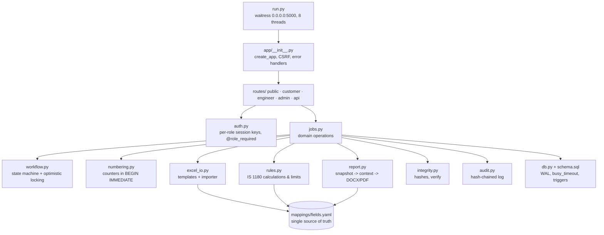

# ATRG architecture

## Data flow

```mermaid
flowchart LR
    subgraph Customer portal
      C1[Request form<br/>CPRI/QAF/01A + proforma] -->|or upload| C0[customer_request_template.xlsx]
    end
    subgraph Admin portal
      A1[Accept: condition check] --> A2[numbering.py<br/>HVD25S0847 / CPRIBLRSCL25T1654]
      A2 --> A3[Work instruction<br/>CPRI/QAF/02]
      A3 --> A4[Assign engineers]
      A6[Review: rules, corrections,<br/>live preview] --> A7[Approve & Issue]
    end
    subgraph Engineer portal
      E1[Download logsheet .xlsx<br/>header pre-filled] --> E2[Fill readings over {{tokens}}]
      E2 --> E3[Upload] --> E4[excel_io.import_workbook<br/>defined names -> token scan]
      E4 --> E5[(readings<br/>imported_value / current_value)]
      E5 --> E6[Correct value + reason<br/>-> corrections]
      E5 --> E7[rules.py -> test_results]
      E7 --> E8[Verify each station -> Lock]
    end
    C1 --> DB[(SQLite WAL)]
    A4 --> E1
    E8 --> A6
    A7 --> S1[Canonical JSON snapshot]
    S1 --> R1[report.py + report_template.docx<br/>docxtpl]
    R1 --> R2[DOCX -> PDF<br/>LibreOffice / MS Word]
    R2 --> S2[SHA-256 of snapshot, DOCX, PDF<br/>-> reports, is_sealed=1]
    S2 --> V[Verify integrity / public /verify/&lt;no&gt;]
    S2 --> CD[Customer downloads]
```

## Modules



## Integrity layers

| Layer | Mechanism |
|---|---|
| Concurrent edits | `version` column on requests / readings; stale writes get HTTP 409 "changed by X at T; reload" |
| Number allocation | `counters` table updated inside `BEGIN IMMEDIATE`; unique indexes on sample code / report no |
| State changes | `workflow.apply()` checks seal, version, legal transition and role on the server |
| Imported data | `imported_value` never edited; every correction stored in append-only `corrections` with reason |
| After issue | SQLite `BEFORE INSERT/UPDATE/DELETE` triggers abort on sealed jobs; `reports`, `files`, `corrections`, `audit_log` are append-only |
| Report files | stored in `storage/sealed/<report_no>/` read-only; SHA-256 of snapshot, DOCX, PDF kept in `reports` |
| Activity log | `row_hash = sha256(prev_hash + row)`; "Verify chain" detects any edit even if triggers were dropped |

## Report template structure (`python-docx` table index)

| Table | Sheet | Content |
|---|---|---|
| T0 | 1 | cover: report no/date, customer, manufacturer, particulars, sample code, documents count, signatures (+ QR) |
| T1 T3 T7 T10 T16 T21 T29 T32 T37 | 2–11 | per-sheet header "Test Report Number … Date …" |
| T2 | 2 | description of sample (proforma) |
| T4–T6 | 3 | summary, schedule of tests (only requested rows), oscillogram/graph/photo numbers |
| T8 | 4 | drawings (row loop) |
| T11–T15 | 5 | winding resistance @75 °C, voltage ratio (row loop), vector group, impedance/load loss, no-load loss |
| T17–T20 | 6 | energy efficiency (total losses), IR, induced, separate source |
| T22–T24 | 7 | short-circuit conditions, X/R & required Isc, oscillograms S002–S011 |
| T25–T28 | 8 | reactance before/after, inspection, oil leakage, routine pressure |
| T30–T31 | 9 | temperature rise |
| T33–T36 | 10 | type pressure/vacuum, no-load current at 112.5 %, conclusion |
| T38 | 11 | notes |

`tools/make_template.py` converts the original format into `templates/report_template.docx`; sheets
and sections without a requested test are wrapped in `` / `` and every sheet
starts with an explicit page break, so "Sheet N of M" is always correct.
